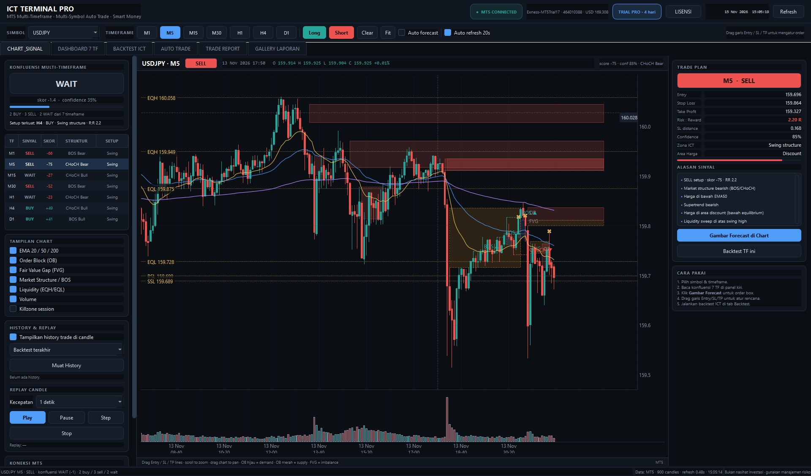

# ICT Terminal Pro

Aplikasi desktop Windows untuk **charting MetaTrader 5 multi-timeframe**, sinyal **BUY/SELL**, **order box ala TradingView**, dan **backtest metode ICT/Smart Money Concepts** — lengkap dengan laporan gambar.

Dibuat dengan Python + PyQt6 + pyqtgraph + MetaTrader5, dan dipaketkan menjadi satu file `.exe`.



---

## Fitur utama

| Fitur | Keterangan |
|---|---|
| **Chart real-time MT5** | Candlestick + volume, 7 timeframe: M1, M5, M15, M30, H1, H4, D1 |
| **Sinyal multi-timeframe** | Skor konfluensi -100…+100, label BUY / SELL / WAIT per timeframe dan agregat |
| **Dashboard live 7 TF** | Tab `DASHBOARD 7 TF` — 7 mini-chart tajam tanpa scaling gambar; klik panel untuk buka chart |
| **ICT overlays** | Order Block (demand/supply), Fair Value Gap, BOS/CHoCH, liquidity sweep, EQH/EQL, BSL/SSL |
| **Indikator** | EMA 20/50/200, RSI, MACD, ATR, ADX, Supertrend, Bollinger |
| **Trade plan** | Entry, Stop Loss, Take Profit, R:R, confidence, alasan sinyal |
| **Order box TradingView-style** | Kotak risk/reward dengan garis Entry / SL / TP yang bisa di-drag; mode **Long** dan **Short** |
| **Auto forecast** | Skenario proyeksi entry → retest → target, plus cone ketidakpastian |
| **Backtest ICT** | Event-driven, mendukung semua timeframe, RR & threshold dapat diatur |
| **Auto Trade Python** | Multi-symbol: centang beberapa simbol, eksekusi order MT5, 1 BUY + 1 SELL per TF **per simbol**, risk global 0.5%/trade, total risk 2%, max DD 4%, TP RR/struktur |
| **Notifikasi Telegram** | Kirim pesan saat sinyal ditemukan dan saat order berhasil dibuka, lengkap dengan nama simbol |
| **History & Replay** | Marker trade historis di candle (backtest / Auto Trade MT5) + play/pause/step replay |
| **Trade Report multi-symbol** | Kalender bulanan P/L + filter **satu simbol atau semua simbol**: jumlah order, profit, loss, win rate, net P/L, dan tabel trade |
| **Export XLSX** | Export trade report ke Excel: summary, trades, daily, per simbol, per TF, dan kalender P/L |
| **Export laporan** | Chart backtest per TF, summary multi-TF, forecast, dan dashboard — otomatis tersimpan di `reports/` |
| **Gallery** | Melihat kembali semua gambar backtest/forecast di dalam aplikasi |
| **Mode demo** | Jika MT5 tidak terhubung, aplikasi tetap terbuka memakai data candle sintetis |

---

## Cara menjalankan

### 1. Dari file .exe (paling mudah)

File siap pakai:

- `dist\ICT-Terminal-Pro-2.0.4.exe`
- `dist\ICT-Terminal-Pro-2.0.4-native-win64.zip` (Nuitka native, folder + exe)
- `dist\ICT-Terminal-Pro-2.0.4-win64.zip` (satu exe + panduan + laporan)

Jika memakai file zip, ekstrak dulu, lalu jalankan `ICT-Terminal-Pro-2.0.4.exe` yang ada di folder hasil ekstrak.

1. Buka **MetaTrader 5**, login ke akun (demo/real), biarkan terminal berjalan.
2. Jalankan `ICT-Terminal-Pro-2.0.4.exe` (dari folder `dist` bila memakai source, atau dari folder hasil ekstrak zip).
3. Tunggu 10–60 detik saat pertama kali (one-file exe melakukan ekstraksi internal + inisialisasi MT5).
4. Pilih simbol & timeframe, lalu klik **Refresh** bila perlu.

> Build ulang: jalankan `build_pro.bat`. Hasil ada di `dist\ICT-Terminal-Pro-2.0.4.exe`.
> Nama file memuat versi supaya Windows tidak memakai cache ikon lama di taskbar.

### 2. Dari source code

```bat
python -m pip install -r requirements.txt
run.bat
```

atau:

```bat
python main.py
```

### 3. Generate semua gambar backtest tanpa membuka UI

```bat
python main.py --reports --bars 5000
```

Hasil tersimpan di folder `reports/`.

---

## Panduan singkat di aplikasi

1. **Pilih simbol** di combobox (bisa diketik untuk mencari, mis. `XAUUSD`, `EURUSD`, `NAS100`).
2. **Pilih timeframe** lewat tombol M1…D1, atau klik baris tabel konfluensi di panel kiri.
3. Panel kiri menunjukkan:
   - sinyal agregat 7 timeframe,
   - tabel sinyal per timeframe,
   - checkbox overlay chart,
   - status akun & koneksi MT5.
4. Panel kanan menunjukkan **Trade Plan** untuk timeframe aktif.
5. Klik **Gambar Forecast di Chart** untuk membuat order box.
6. Klik **Long** atau **Short** lalu klik area chart untuk menaruh order box manual.
7. **Drag** garis Entry, SL, TP, dan batas waktu untuk mengubah rencana.
8. Tombol **Clear** menghapus semua order box; **Fit** mengembalikan zoom.
9. Buka tab **BACKTEST ICT**:
   - pilih semua timeframe atau satu timeframe,
   - atur jumlah candle, target RR, skor minimum, risiko per trade, filter killzone,
   - klik **Jalankan Backtest**,
   - klik **Export Gambar Laporan** untuk membuat chart, summary, forecast, dashboard.
10. Buka tab **DASHBOARD 7 TF** untuk melihat 7 mini-chart live (15 candle terakhir per panel).
    - Klik salah satu panel untuk langsung membuka chart timeframe tersebut.
11. Tab **GALLERY LAPORAN** menampilkan semua gambar yang pernah dibuat.
    - **Dashboard Baru** membuat dashboard PNG V4 (16 candle/panel) dari data terbaru.
    - Viewer default **Fit Width**; gunakan **100%**, scroll untuk zoom, drag untuk geser.
    - Double-click nama file untuk membuka PNG di viewer Windows.
12. Tab **AUTO TRADE** mengirim order otomatis ke **beberapa simbol** di akun MT5 yang sedang login.
    - **Chart dan dashboard tetap single-symbol**; hanya engine auto trade yang multi-symbol.
    - Di kartu **Simbol yang Ditradingkan**, centang simbol yang boleh ditradingkan (maksimal **12** simbol per engine). Gunakan kolom pencarian atau tombol `+` untuk menambah simbol.
    - Pilih TF dengan checkbox; tiap simbol + TF punya magic **BUY dan SELL** sendiri:
      maksimal **1 BUY + 1 SELL per TF per simbol** (hedging). Posisi BUY tidak menghalangi sinyal SELL baru.
    - Akun harus mode **hedging** agar BUY dan SELL bisa terbuka bersamaan.
    - **Risk 0.5% per trade** dihitung dari equity; **max total risk 2% dihitung global untuk semua simbol**; **max DD 4% global**.
    - Mode TP: **RR manual** atau **Struktur liquidity**.
    - Pada mode **Struktur liquidity**, field RR dinonaktifkan dan TP murni memakai swing/liquidity; jika target tidak valid (<0.8R), trade dilewati (tidak fallback ke RR).
    - Risk per trade, max total risk, max drawdown, spread, dan batas bar dapat diatur.
    - **STOP ENGINE** menghentikan entry baru; posisi yang sudah terbuka tetap ada.
    - **STOP ALL · TUTUP POSISI** menutup semua posisi milik engine (semua simbol) dan menghentikan engine.
    - Max DD 4% = **stop entry baru**; posisi lama tetap dikelola SL/TP. Gunakan STOP ALL untuk menutup semuanya.
    - Engine hanya berjalan selama aplikasi Python hidup; SL/TP tetap tersimpan di server MT5.
    - Log evaluasi tiap candle menyertakan **simbol + TF**: `WAIT`, `HOLD`, `SKIP` + alasan, atau `VALID -> kirim order`.
    - Posisi dan sinyal terakhir ditampilkan per simbol; Telegram juga menyertakan nama simbol.
13. Panel **HISTORY & REPLAY** di tab Chart:
    - **Tampilkan history trade** → marker entry/exit, kotak SL/TP, dan label R di candle sebelumnya.
    - Sumber **Backtest terakhir** atau **Auto Trade MT5** (history deal berdasarkan magic number).
    - **Play/Pause/Step/Stop** untuk replay candle dari beberapa ratus bar terakhir.
    - History juga tampil di panel **DASHBOARD 7 TF** (30 candle/panel).
14. Tab **TRADE REPORT** untuk rekap Auto Trade per tanggal dan per simbol:
    - pilih **Simbol** (satu simbol) atau **Semua Simbol**,
    - tampilan **kalender bulanan**: tiap tanggal berisi net P/L (USD) dan jumlah trade,
    - hijau = profit, merah = loss; klik tanggal untuk melihat detail order hari itu,
    - tombol `sebelumnya` / `berikutnya` untuk pindah bulan, `Bulan ini` untuk kembali ke bulan berjalan,
    - pilih rentang tanggal **Dari / Sampai** dan filter **tanggal entry** atau **tanggal exit**,
    - lihat jumlah order closed, profit, loss, win rate, net P/L, gross profit/loss, avg R,
    - tabel detail ticket, **simbol**, TF, arah, lot, waktu, entry/exit, profit, R,
    - kalender **Semua Simbol** menampilkan P/L gabungan; pilih simbol untuk kalender per simbol,
    - waktu ditampilkan dalam **waktu lokal** komputer,
    - klik **Export XLSX** untuk menyimpan laporan sesuai filter aktif ke file Excel.
      Sheet yang dibuat: **SUMMARY**, **TRADES**, **DAILY**, **PER SYMBOL**, **PER TF**, dan **CALENDAR**.

### Notifikasi Telegram

1. Buat bot lewat **@BotFather** di Telegram, salin **bot token**.
2. Dapatkan **chat ID** (misalnya lewat @userinfobot, atau `getUpdates`).
3. Buka tab **AUTO TRADE** → bagian **NOTIFIKASI TELEGRAM**.
4. Isi token dan chat ID, klik **Test Telegram**.
5. Aktifkan checkbox notifikasi sebelum **MULAI AUTO TRADE**.

Pesan yang dikirim:

- `🔔 SINYAL ICT` saat setup BUY/SELL ditemukan.
- `✅ ORDER OPENED` saat order berhasil dibuka (lot, entry, SL, TP, ticket).

Token disimpan lokal di QSettings Windows. Jangan bagikan token ke orang lain.
Telegram hanya mengirim notifikasi; eksekusi order tetap dilakukan oleh engine MT5 di aplikasi.

### Auto Trade (Python) — catatan penting

- Ini **bukan EA MQL5**: order dikirim lewat `MetaTrader5.order_send()` dari aplikasi.
- **Monitor/chart tetap satu simbol**; engine auto trade memproses semua simbol yang dicentang.
- **Magic number bisa diubah** dari halaman Auto Trade (kolom *Magic number*, default `770000`). Skema tetap per TF + arah: BUY = magic + 1000 + nomor TF, SELL = magic + 1100 + nomor TF, dipakai bersama semua simbol. Posisi dibedakan berdasarkan **(simbol, ticket)**, sehingga aman untuk multi-symbol dan tetap kompatibel dengan order versi single-symbol sebelumnya. Laporan/history membaca magic yang sedang aktif **dan** magic lama, jadi trade lama tidak hilang.
- **Risk total 2% bersifat global**: total risiko seluruh posisi Auto Trade di semua simbol tidak boleh melebihi 2% equity.
- Maksimal **12 simbol** per engine agar scan MT5 tetap ringan.
- MT5 harus terbuka, login, dan **Algo Trading aktif**.
- Backtest Python dan eksekusi live tidak akan identik 100% (spread, slippage, tick, eksekusi).
- Hasil backtest saat ini belum kuat untuk live agresif: PF 1.03, drawdown per TF 12–25%.
- Wajib uji di akun **demo** lebih dulu.
- Tutup aplikasi **tidak** menutup posisi yang sudah terbuka; SL/TP tetap aktif di server.

---

## Logika sinyal

Skor tiap timeframe dihitung dari konfluensi:

| Komponen | Bobot |
|---|---|
| Market structure BOS/CHoCH | ±24 |
| Harga vs EMA50 | ±12 |
| Harga vs EMA200 | ±8 |
| EMA20 vs EMA50 | ±7 |
| Supertrend | ±8 |
| RSI (momentum / overbought-oversold) | ±4…±6 |
| MACD histogram | ±7 |
| Discount / premium | ±8 |
| Reaksi di Order Block | ±12 |
| Harga mengisi FVG | ±6 |
| Liquidity sweep | ±11 |
| ADX > 22 (penguat) | ×1.08 |

* **BUY** jika skor ≥ +30, **SELL** jika ≤ −30, selain itu **WAIT**.
* Agregat memakai bobot timeframe: M1 0.5 → D1 3.5.
* Entry memakai harga terakhir; SL di luar zona/swing + buffer ATR; TP di liquidity terdekat atau minimal 1.5R.
* Confidence adalah estimasi kekuatan sinyal, **bukan probabilitas menang**.

> Sinyal dan forecast bersifat teknikal-probabilistik. Selalu gunakan manajemen risiko.

---

## Metodologi backtest ICT

Model yang diuji:

**Entry**
- Bias mengikuti market structure (BOS/CHoCH).
- Filter tren: EMA20/50/200, MACD histogram, RSI, ADX.
- Harga berada di discount (long) / premium (short) dari range 40 bar.
- Harus ada elemen ICT: retest Order Block/FVG **atau** liquidity sweep.
- Konfirmasi candle searah.
- Entry pada **open candle berikutnya** (tidak ada look-ahead).

**Exit**
- SL di luar zona / swing + buffer 0.25 ATR.
- TP = RR × risiko (default 2.0R).
- SL dicek lebih dulu bila satu candle menyentuh SL dan TP.
- Timeout **45 candle untuk M1/M5/M15** dan **60 candle untuk M30/H1/H4/D1** — aturan ini selalu per TF, tidak berubah saat memilih “Semua timeframe”.
- Hanya candle yang sudah close yang dipakai untuk backtest.
- Spread broker + komisi 0.015R diperhitungkan.
- Risiko 1% equity per trade, compounding.
- Satu posisi pada satu waktu per timeframe, cooldown 2 candle.

**Parameter laporan ini**
- Simbol: XAUUSD
- Data: MetaTrader 5, 5.000 candle per timeframe
- RR: 1.5
- Skor minimum: 7
- Filter killzone: nonaktif
- Risiko: 1% per trade

### Hasil sampel (XAUUSD, 26 Okt 2026)

| TF | Trades | Win % | PF | Expectancy | Net R | Max DD |
|---|---:|---:|---:|---:|---:|---:|
| M1 | 202 | 41.6% | 0.90 | −0.06R | −12.1R | 21.5% |
| M5 | 217 | 42.4% | 0.95 | −0.03R | −6.2R | 21.1% |
| M15 | 211 | 40.3% | 0.93 | −0.04R | −8.4R | 25.0% |
| M30 | 208 | 45.7% | 1.15 | +0.08R | +16.7R | 14.1% |
| H1 | 210 | 45.7% | 1.18 | +0.09R | +19.9R | 13.1% |
| H4 | 246 | 42.7% | 1.03 | +0.02R | +4.7R | 12.5% |
| D1 | 180 | 44.4% | 1.10 | +0.06R | +10.1R | 22.8% |
| **Total** | **1474** | **43.2%** | **1.03** | — | **+24.7R** | — |

**Catatan penting:** hasil di atas adalah sampel riset, bukan jaminan profit.
M1, M5, dan M15 negatif pada sampel ini; M30/H1/H4/D1 positif. Drawdown per TF bisa di atas 20%.
Uji ulang dengan simbol, periode, RR, dan filter sesi yang berbeda sebelum dipakai.

**Perbaikan backtest:** seluruh zona Order Block/FVG dan sweep sepanjang history sekarang ikut dihitung.
Sebelumnya daftar zona dibatasi 60 terakhir, sehingga menambah jumlah candle tidak menambah sampel perdagangan.

Gambar lengkap:
- `reports/ict_backtest_XAUUSD_<TF>_<timestamp>.png`
- `reports/ict_summary_XAUUSD_<timestamp>.png`
- `reports/ict_forecast_XAUUSD_<timestamp>.png`
- `reports/ict_dashboard_XAUUSD_<timestamp>.png`

---

## Struktur proyek

```text
mt5_indikator/
├── main.py                     # entry point + CLI (--reports, --selftest)
├── build.bat                   # build .exe (PyInstaller one-file)
├── run.bat                     # jalankan dari source
├── generate_reports.bat        # generate gambar backtest
├── requirements.txt
├── assets/
│   └── icon.ico / icon.png
├── ictterm/
│   ├── config.py               # konstanta, timeframe, tema, path
│   ├── data.py                 # koneksi & cache data MT5 + fallback demo
│   ├── indicators.py           # EMA, RSI, MACD, ATR, ADX, Supertrend, dll.
│   ├── ict.py                  # swing, BOS/CHoCH, OB, FVG, sweep, EQH/EQL
│   ├── signals.py              # skor multi-TF, trade plan, forecast path
│   ├── backtest.py             # event-driven backtester
│   ├── reporting.py            # render PNG (matplotlib)
│   ├── app.py                  # main window
│   └── widgets/
│       ├── chart.py            # candlestick chart + overlay + crosshair
│       ├── order_tool.py       # order box yang bisa di-drag
│       ├── panels.py           # confluence, signal table, trade plan, dsb.
│       └── backtest_tab.py     # backtest lab + gallery
├── reports/                    # output gambar
└── dist/
    └── ICT-Terminal-Pro-2.0.4.exe
```

---

## Troubleshooting

**“MT5 tidak terhubung” / data tidak update**
- Pastikan terminal MetaTrader 5 sudah login dan tidak di-minimize total.
- Buka MT5 → Tools → Options → Expert Advisors → centang *Allow algorithmic trading* (opsional untuk data).
- Klik **Refresh** di aplikasi.
- Pastikan simbol tersedia di Market Watch (aplikasi otomatis `symbol_select`).
- Jika memakai exe di komputer lain, install MetaTrader 5 terlebih dahulu.

**Simbol tidak ditemukan**
- Broker bisa memakai suffix, mis. `XAUUSDm`, `EURUSD.a`. Ketik nama persis dari Market Watch.
- Untuk akun non-Exness, nama simbol dan jam server bisa berbeda (killzone hanya perkiraan).

**Chart kosong / hanya beberapa candle**
- MT5 mungkin belum mengunduh history. Buka chart simbol di MT5, scroll ke kiri, lalu Refresh.
- Coba kurangi `Jumlah candle` di backtest.

**Build .exe gagal**
- Jalankan `build.bat` sebagai Administrator bila folder `dist` terkunci.
- Pastikan Python 3.11 64-bit dan paket di `requirements.txt` terpasang.
- Antivirus kadang memblokir PyInstaller one-file; tambahkan pengecualian folder proyek.

**Startup .exe lambat**
- Wajar untuk one-file (ekstraksi ke temp). Versi `--onedir` lebih cepat jika diinginkan:
  ubah `--onefile` menjadi `--onedir` di `build.bat`.

**Laporan tidak muncul**
- Semua gambar disimpan di `reports/` sebelah file `.exe`.
- Klik **Buka Folder Reports** di tab Backtest/Gallery.

---

## Disclaimer

Aplikasi ini adalah alat analisis teknikal dan riset backtest. Bukan nasihat keuangan/investasi.
Perdagangan forex, emas, indeks, dan crypto memiliki risiko kehilangan modal.
Hasil backtest tidak menjamin performa masa depan. Gunakan uang yang siap kehilangan dan manajemen risiko yang ketat.

---

## Lisensi & Edisi (v2.0.4 PRO)

Aplikasi ini memakai sistem lisensi offline berbasis HWID:

| Tahap | Hari | Yang didapat |
|---|---|---|
| **TRIAL PRO** | 1 - 7 | semua fitur PRO terbuka (badge biru) |
| **TRIAL** | 8 - 30 | bot aktif dengan batasan: maks 5 pair, risk 0.1%/trade, total risk 4%, max DD 4%, skor minimum 10.0, RR 1.5, TP RR — semua pengaturan dikunci, hanya pilihan pair yang bisa diubah (badge emas) |
| **BOT TERKUNCI** | 31+ | bot auto trade mati total; chart, sinyal, dan backtest tetap bisa dipakai (badge merah) |
| **PRO** | kapan saja | key aktivasi 1/3/6/12 bulan atau lifetime (badge hijau) — masa aktif dihitung **sejak key diaktifkan**, bukan sejak key dibuat |

Saat bot terkunci muncul ajakan membeli lisensi ke **0812-2578-0898**.

Data lisensi disimpan di 8 salinan (registry + beberapa folder, tersembunyi)
ditambah 3 anchor bertanda tangan HMAC. Menghapus `license.dat` atau registry
aplikasi **tidak** mereset masa gratis/aktivasi: aplikasi memulihkan tanggal
asli dari anchor. Aktivasi ulang key yang sama juga tidak menambah masa aktif.

Tombol **LISENSI** di header membuka dialog aktivasi (HWID + input key).
Key generator untuk penjual ada di `tools/keygen.py` dan **tidak boleh**
dibagikan ke pembeli. Panduan lengkap: `LICENSE_GUIDE.md`.

Key aktivasi memakai **Ed25519** (format `ICT3-XXXX-…`, 30 grup). Aplikasi
hanya membawa public key, jadi membongkar exe tidak bisa menghasilkan keygen
palsu. Key lama `ICT-XXXX-…` tidak diterima lagi untuk aktivasi baru; pembeli
existing mendapat key baru yang membawa sisa masa aktifnya
(`tools/convert_keys.py`). Detail proteksi build: `SECURITY_BUILD.md`.

```bat
build_pro.bat      :: build aplikasi yang dijual (dist\ICT-Terminal-Pro-2.0.4.exe)
build_nuitka.bat   :: build dengan kompilasi native (proteksi kode lebih kuat)
build_keygen.bat   :: build key generator rahasia (dist\ICT-Keygen.exe)
sign_exe.bat       :: tanda tangani exe (butuh Code Signing Certificate)
tools\reset_trial.bat :: reset data lisensi untuk testing (vendor only)
```

Logika auto trade tidak diubah: pembatasan hanya menge-clamp
`AutoTradeConfig` sebelum engine dijalankan dan menonaktifkan kontrol di UI.


## Bukti keaslian EA (untuk prop firm / broker)

Kalau prop firm meminta bukti bahwa EA ini buatan sendiri:

```bat
.venv\Scripts\python.exe tools\make_bukti_paket.py
```

Perintah itu membuat folder `BUKTI_KEPEMILIKAN/` (kirim sebagai ZIP) berisi:

- `BUKTI_KEASLIAN_EA.md` - surat pernyataan + arsitektur + daftar yang aman
- `src/ictterm/*.py` - 11 modul strategi (config dalam versi redaksi)
- `manifest_sha256.txt` - sidik jari SHA-256 modul, exe, dan PDF
- `bukti_gambar/` - screenshot aplikasi + laporan backtest/forecast

Yang tidak pernah masuk paket: `licensing.py`, `tools/vendor/`,
`ed25519_private.key`, keygen, dan riwayat pembeli. Detail: `BUKTI_KEASLIAN_EA.md`.
